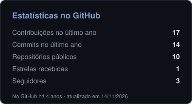
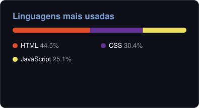

### Olá, eu sou o Alexandre! 

💼 **Suporte e desenvolvimento** na [Auto Controller System](https://autocontrollersystem.com.br), empresa de rastreamento e videomonitoramento veicular. 
🎓 Formado em **Análise e Desenvolvimento de Sistemas** (UniCesumar, 2024). 
🚀 Construo soluções reais para o dia a dia da empresa: site institucional, chatbot de atendimento e um sistema interno de gestão.

---

### 🌟 Projetos em destaque

**[Site Auto Controller System](https://github.com/AlexandreGregorio/site-auto-controller)** · [ver no ar](https://autocontrollersystem.com.br) 
Site institucional com **central de atendimento própria**: um chatbot que tira dúvidas, faz a triagem por setor e envia um resumo pronto para o WhatsApp. Tem também planos com quiz, área do cliente para acompanhar a ordem de serviço, tema escuro, LGPD e SEO. 
`HTML` `CSS` `JavaScript`

**Central AC** *(sistema interno, código privado)* 
Plataforma de gestão com ordens de serviço, financeiro, cobrança automática por e-mail e registro de ponto CLT. Funciona como aplicativo no celular (PWA). 
`PHP 8` `MySQL` `JavaScript`

---

### 🛠️ Tecnologias

**Base da formação**

  &nbsp;&nbsp;
  &nbsp;&nbsp;
  &nbsp;&nbsp;
  &nbsp;&nbsp;
  &nbsp;&nbsp;
  

**Aprendendo na prática** · em projetos reais da Auto Controller, desenvolvidos com apoio de IA

  &nbsp;&nbsp;
  &nbsp;&nbsp;
  &nbsp;&nbsp;
  &nbsp;&nbsp;
  

PHP · MySQL · Google Apps Script · PWA · Claude (IA)

### 📊 Estatísticas

  &nbsp;
  

### 📫 Contato

<picture>
  <source media="(prefers-color-scheme: dark)" srcset="https://raw.githubusercontent.com/AlexandreGregorio/alexandregregorio/output/github-contribution-grid-snake-dark.svg">
  
</picture>
